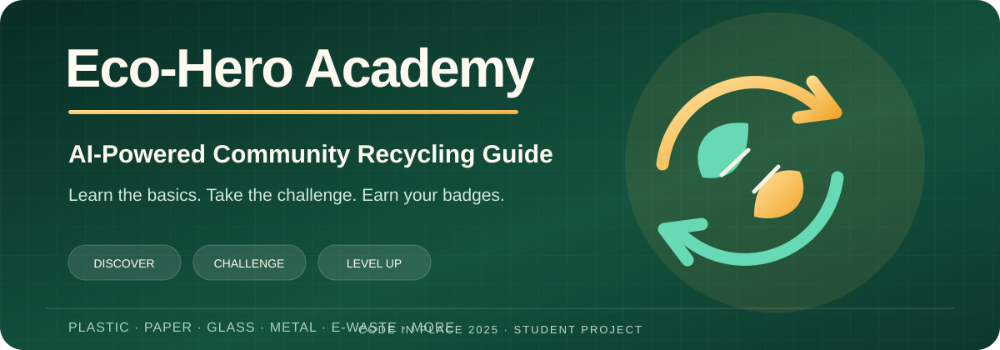

  

  <strong>Small choices. Cleaner communities.</strong> 
  A gamified, local-first recycling education project from Code in Place 2025.

  
  
  
  

---

## About the project

**AI-Powered Community Recycling Guide**, presented through **Eco-Hero Academy**, is a Python terminal project originally created as a Code in Place 2025 final project. It turns recycling basics into a small learning game with material guides, an Eco Advisor, five-question challenges, adaptive review, saved profiles, a local leaderboard and unlockable badges.

This repository is a structured, tested refactor of the original project. It keeps the original learning content and core mechanics while separating content, profile data, persistence, game rules and the terminal interface into maintainable modules.

## Features

| Feature | What it does |
|---|---|
| **Material guide** | Tips, items to keep out of recycling, and a fun fact for nine material categories. |
| **Guide presets** | Two named demonstration presets from the original project, plus a general guide. |
| **Eco Advisor** | Answers common recycling questions using transparent keyword and rule matching. |
| **Eco-Challenge** | Five-question True/False and multiple-choice rounds with explanations. |
| **Adaptive review** | Brings up to two questions missed in the previous round back into the next round. |
| **Profiles** | Create, load, and save local player profiles in a JSON file. |
| **Badges** | Seven achievements for participation, score, topic exploration and perfect rounds. |
| **Leaderboard** | Ranks profiles stored in the same local profile file. |

## Important note about the “AI” name

The original **Eco-AI Advisor** is a rule-based helper: it matches a question against a set of known topics and returns a prepared explanation. It does **not** use machine learning, a large language model, or an external AI API. The historic project title is preserved, but the implementation is described accurately here.

## Run it

### Requirements

- Python 3.10 or newer
- No third-party Python dependencies

### 1. Clone the repository

    git clone https://github.com/krlhsn/ai-powered-community-recycling-guide.git
    cd ai-powered-community-recycling-guide

### 2. Run the application

    python main.py

Or install it in editable mode and use the command-line entry point:

    python -m pip install -e .
    eco-hero

The first profile save creates `eco_hero_profiles.json` in the current working directory. The file is local to that computer; it is not a hosted or shared account system.

### 3. Run the tests

    python -m unittest discover -s tests -v

## How to play

1. Start the app and choose **Manage Profiles**.
2. Create a profile or load an existing local profile.
3. Open a material guide, take an Eco-Challenge, ask the Eco Advisor, view badges, or choose a guide preset.
4. Save and log out to persist your progress.

The leaderboard includes profiles in the same local JSON file only. It is not an online leaderboard.

## Recycling-content limitations

Recycling acceptance rules vary by city, collection provider, facility and material. The original project includes two fictional demo presets, **Eco-City Standard** and **Greenburg Initiative**. They are retained to demonstrate how regional data can change a tip; they are not real municipal programmes and should not be used as local disposal instructions.

The general material tips and facts are carried forward from the original student project and have not been independently fact-checked as part of this refactor. Check your local authority or waste provider before disposing of batteries, electronics, light bulbs, chemicals or other potentially hazardous items. The project is for education, not official waste-management advice.

## Project structure

    ai-powered-community-recycling-guide/
    ├── .github/workflows/tests.yml
    ├── assets/eco-hero-banner.svg
    ├── docs/PROJECT_NOTES.md
    ├── legacy/original_2025_console.py.gz
    ├── eco_hero/
    │   ├── __init__.py
    │   ├── cli.py
    │   ├── data.py
    │   ├── engine.py
    │   ├── models.py
    │   └── storage.py
    ├── tests/
    ├── .gitignore
    ├── CITATION.cff
    ├── CONTRIBUTING.md
    ├── LICENSE
    ├── main.py
    ├── PRIVACY.md
    ├── pyproject.toml
    ├── README.md
    └── SECURITY.md

## Privacy and data storage

Eco-Hero runs locally. It does not send profiles, answers or questions to a remote service. Profile data is written to `eco_hero_profiles.json` on the computer running the app. There are no passwords or account recovery features, so do not use sensitive personal information as a username. See [PRIVACY.md](PRIVACY.md).

## Development

The project uses only the Python standard library. Contributions should preserve the distinction between demonstration presets and verified local recycling rules. See [CONTRIBUTING.md](CONTRIBUTING.md).

## Original project and refactor

- **Original project:** AI-Powered Community Recycling Guide / Eco-Hero Academy
- **Context:** Code in Place 2025 final project
- **Refactor:** modular package, validated profile model, atomic JSON persistence, reusable quiz and guide logic, test coverage, documentation and CI

The original console design included ASCII welcome art, a trophy, a profile system, regional guide variants, a quiz, rule-based advisor replies, adaptive review and achievements. These central ideas remain represented in this repository. The original single-file source is preserved as a compressed historical snapshot at `legacy/original_2025_console.py.gz`; see [legacy/README.md](legacy/README.md) for how to restore it.

## Author

**Kamrul Hassan**  
[GitHub](https://github.com/krlhsn) · [LinkedIn](https://www.linkedin.com/in/krlhsn/) · [ORCID](https://orcid.org/0009-0008-2990-1036)

## License

Released under the [MIT License](LICENSE).

---

<em>Be curious. Waste less. Help your community.</em>

